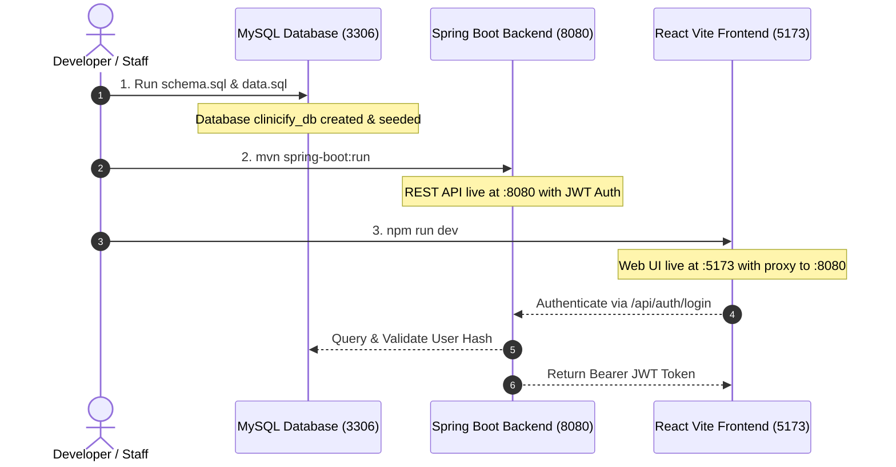

# CLINICIFY — Smart Hospital Management System
**Predictive OPD Queues, Digital Prescriptions, and Inpatient Bed Management**

> **Mini Project Report & Implementation Guide**  
> **Department:** Computer Science and Engineering (Data Science)  
> **Institution:** A. P. Shah Institute of Technology (APSIT), Thane  
> **Academic Year:** 2025–2026  
> **Team:** Bhavesh Baviskar and Project Team | **Project Guide:** Ms. Rajashri Chaudhari  

---

## 📑 Documentation Index

This project is separated into modular, comprehensive execution guides for each layer of the application:

1. 🗄️ **[Database Architecture & Setup Guide](file:///c:/Users/bhave/OneDrive/Desktop/Java_Project/DATABASE.md)**
   * Complete 15-table logical schema (Users, Patients, Visits, Tokens, Consultations, Prescriptions, Pharmacy, Beds, Admissions, Audit).
   * Direct SQL files: [`schema.sql`](file:///c:/Users/bhave/OneDrive/Desktop/Java_Project/schema.sql) & [`data.sql`](file:///c:/Users/bhave/OneDrive/Desktop/Java_Project/data.sql).
   * Concurrency-safe SQL queries (Row locks for bed allocations).

2. ⚙️ **[Backend Architecture & Execution Guide](file:///c:/Users/bhave/OneDrive/Desktop/Java_Project/BACKEND.md)**
   * Java 17+ with Spring Boot 3.x, Spring Data JPA, and Spring Security (Stateless JWT).
   * Full `pom.xml` dependencies and `application.properties`.
   * Dynamic OPD Waiting-Time baseline prediction algorithm.
   * Full REST API endpoint reference across all 4 roles.

3. 🖥️ **[Frontend Architecture & Execution Guide](file:///c:/Users/bhave/OneDrive/Desktop/Java_Project/FRONTEND.md)**
   * Modern React 18+ with Vite, Tailwind CSS, and Lucide Icons.
   * Role-specific dashboards for **Receptionist**, **Doctor**, **Pharmacist**, and **Patient**.
   * Dedicated Fullscreen **Waiting Hall TV Display** for live token callouts.
   * Centralized Axios JWT interceptors and Auth Context.

---

## 🚀 End-to-End Execution Sequence

Follow these 3 steps to run the complete Clinicify platform locally:



---

### Step 1: Initialize Database (MySQL)
Run the pre-configured scripts inside MySQL:
```powershell
mysql -u root -p
```
```sql
SOURCE c:/Users/bhave/OneDrive/Desktop/Java_Project/schema.sql;
SOURCE c:/Users/bhave/OneDrive/Desktop/Java_Project/data.sql;
```

---

### Step 2: Start the Backend (Spring Boot)
Open a new terminal window in the backend directory:
```powershell
cd c:\Users\bhave\OneDrive\Desktop\Java_Project\backend
mvn clean spring-boot:run
```
* **API Base URL:** `http://localhost:8080/api`
* **Health Check:** `http://localhost:8080/api/actuator/health`

---

### Step 3: Start the Frontend (React + Vite)
Open a separate terminal window:
```powershell
cd c:\Users\bhave\OneDrive\Desktop\Java_Project\frontend
npm install
npm run dev
```
* **Web Application:** `http://localhost:5173`
* **Waiting Room Public Display:** `http://localhost:5173/display`

---

## 🔑 Demo Login Credentials

All seeded test users share the default password: **`Password@123`**

| Role | Username | Default Password | Primary Function |
| :--- | :--- | :--- | :--- |
| **Receptionist** | `receptionist1` | `Password@123` | Patient Registration, Token Generation, Bed Allocation |
| **Doctor** | `dr_sharma` | `Password@123` | Call Token, Write Digital Prescriptions, Admit Patients |
| **Pharmacist** | `pharmacist1` | `Password@123` | Dispense Prescriptions, Track Medicine Inventory |
| **Patient** | `patient_rahul` | `Password@123` | View Token Status, Wait Time Countdown, Prescriptions |

