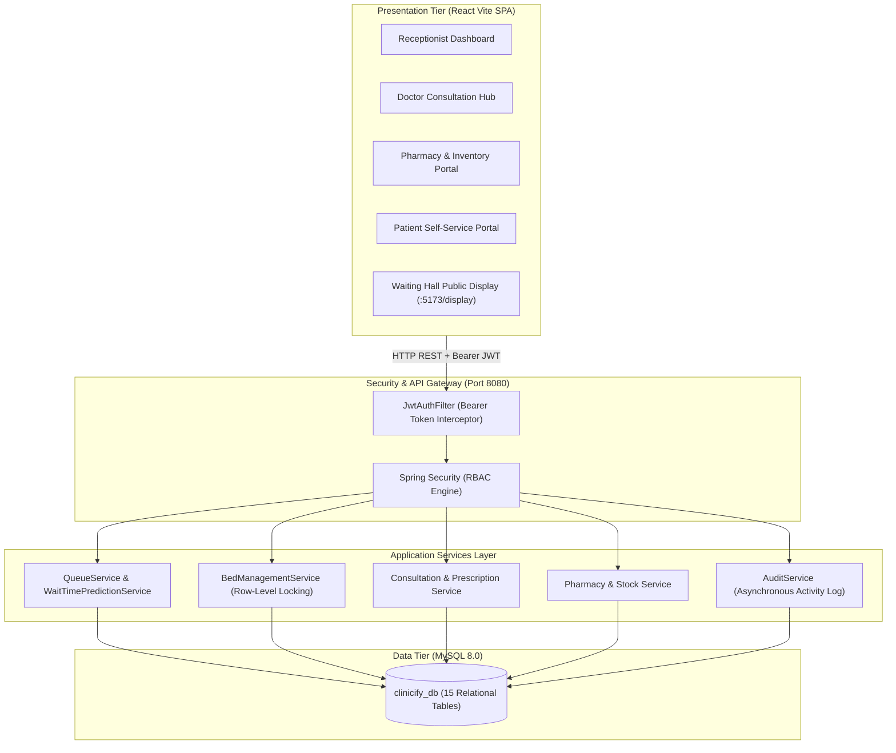
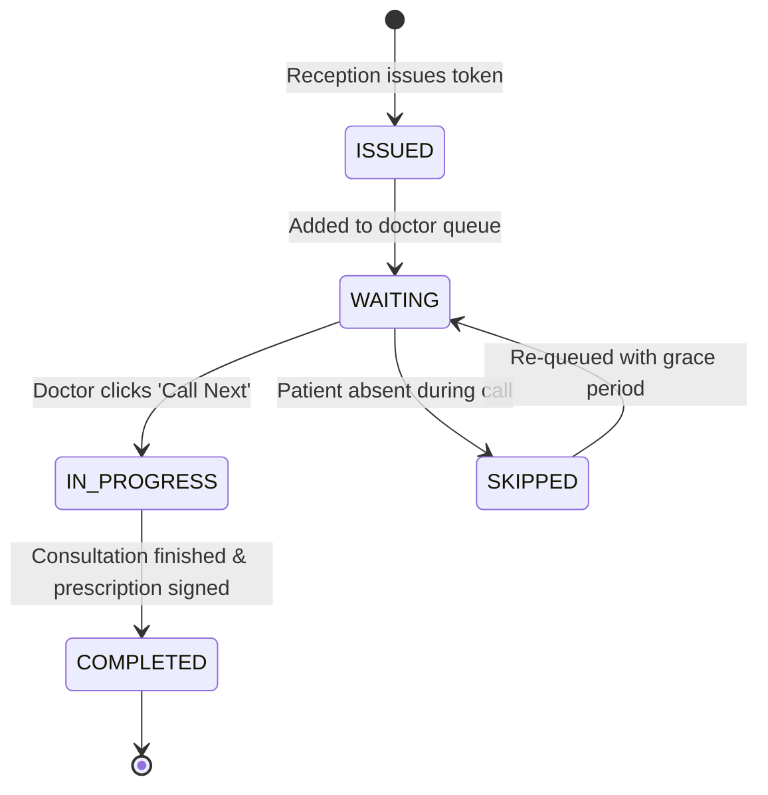
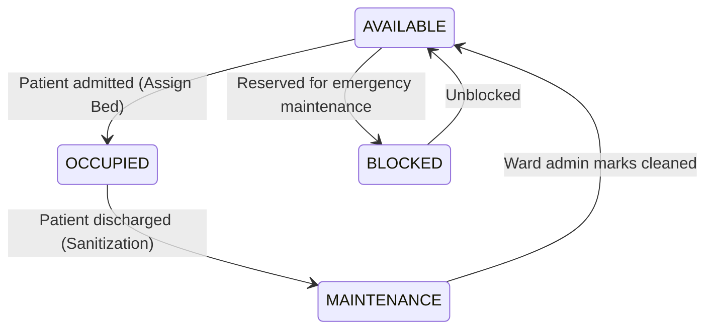

# Clinicify — System Architecture & Design

> Technical architecture specification for the Clinicify Smart Hospital Management System.

---

## 1. High-Level Architecture Overview

Clinicify is structured around a modern 3-tier decoupled architecture:
1. **Presentation Layer (React 18 + Vite + Tailwind CSS)**: Single-Page Application (SPA) providing role-tailored dashboards and a fullscreen real-time waiting hall monitor.
2. **Business & API Layer (Spring Boot 3 + Spring Security + JJWT)**: Stateless REST API managing business rules, queue algorithms, transactional integrity, and role-based access control.
3. **Data Layer (MySQL 8.0 / InnoDB)**: Relational database with strict foreign-key constraints, row-level locking for resource allocation, and audit trails.



---

## 2. Dynamic OPD Queue Baseline Wait-Time Algorithm

Waiting times in traditional hospitals are unpredictable. Clinicify solves this using a dynamic queue prediction service:

### Formulation
For any patient holding queue token $T_i$ assigned to Doctor $D_j$:

$$\text{Estimated Wait Time} = N_{\text{ahead}} \times \overline{T}_{\text{consultation}}$$

Where:
* $N_{\text{ahead}}$ = Number of patients in status `WAITING` or `IN_PROGRESS` ahead of $T_i$ for Doctor $D_j$.
* $\overline{T}_{\text{consultation}}$ = Rolling baseline consultation duration (configurable, default: 12 minutes).

### Dynamic Status Transitions


---

## 3. Concurrency-Safe Bed Allocation State Machine

To prevent double-booking of hospital beds in high-traffic emergency or general wards, Clinicify enforces strict transactional row-level locks:

```sql
-- Explicit row lock during allocation transaction
SELECT * FROM beds WHERE bed_id = :id FOR UPDATE;
```

### Bed Lifecycle State Machine


---

## 4. Security & Stateless JWT Authentication

* **Password Protection**: Passwords hashed with BCrypt (10 rounds).
* **Token Standard**: JSON Web Tokens (JJWT 0.11.5) signed with HMAC-SHA256 (`HS256`).
* **Statelessness**: No session memory on backend; each HTTP request carries `Authorization: Bearer <token>`.
* **RBAC Roles**: `RECEPTIONIST`, `DOCTOR`, `PHARMACIST`, `PATIENT`, `ADMIN`.

---

## 5. Audit Logging Architecture
Every critical state change (prescriptions issued, medicines dispensed, beds allocated, admissions created) records an immutable entry into `audit_logs` tracking:
* `user_id` and `action`
* `entity_name` and `entity_id`
* `timestamp` and `details`
