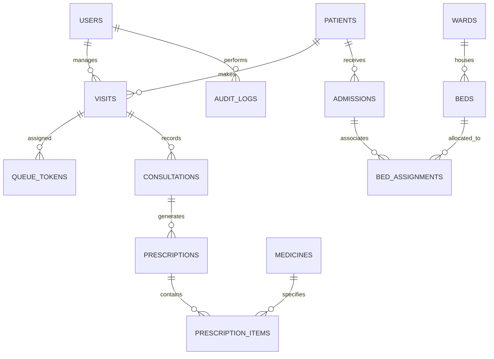

# Clinicify — Database Schema & Data Dictionary

> Complete database layout, entity relationships, and constraints for `clinicify_db`.

---

## 1. Entity-Relationship Overview



---

## 2. Table Catalog (15 Core Tables)

### User & Authentication
* **`users`**: System users (Doctors, Receptionists, Pharmacists, Admins, Patients). Contains `username`, `password_hash` (BCrypt), `role`, `full_name`, `email`, and `active_status`.

### Patient Demographics
* **`patients`**: Master record of patients. Stores `patient_id`, `uhid` (Unique Health Identifier), `full_name`, `dob`, `gender`, `contact_number`, `blood_group`, and `address`.

### OPD Operations & Visits
* **`visits`**: Clinical visit sessions linking patient, department, and doctor.
* **`queue_tokens`**: Daily OPD token system. Holds `token_number`, `token_date`, `status` (`WAITING`, `IN_PROGRESS`, `COMPLETED`, `SKIPPED`), `estimated_wait_minutes`, and `called_time`.

### Consultations & Medical Records
* **`consultations`**: Doctor clinical encounter details including `diagnosis`, `clinical_notes`, and JSON vitals (`blood_pressure`, `pulse`, `spo2`, `temperature`).
* **`prescriptions`**: Formal prescription headers signed by doctors.
* **`prescription_items`**: Individual medicine rows (`medicine_id`, `dosage`, `frequency`, `duration_days`, `dispensed_status`).

### Pharmacy Inventory
* **`medicines`**: Drug catalog (`brand_name`, `generic_name`, `unit_price`, `stock_quantity`, `reorder_threshold`, `expiry_date`).

### Inpatient & Bed Management
* **`wards`**: Ward definitions (`GENERAL`, `ICU`, `MATERNITY`, `PEDIATRIC`, `EMERGENCY`).
* **`beds`**: Individual beds with `ward_id`, `bed_number`, and `status` (`AVAILABLE`, `OCCUPIED`, `MAINTENANCE`, `BLOCKED`).
* **`admissions`**: Inpatient admission sessions (`patient_id`, `admission_date`, `discharge_date`, `status`).
* **`bed_assignments`**: Historical log linking `admission_id`, `bed_id`, `start_time`, and `end_time`.

### Governance & Auditing
* **`audit_logs`**: Immutable security and activity event log (`user_id`, `action`, `entity_name`, `entity_id`, `timestamp`, `details`).

---

## 3. Concurrency Protection & Indexing Strategies

### Row Locks
When booking a bed:
```sql
SELECT bed_id, status FROM beds WHERE bed_id = ? FOR UPDATE;
```
Ensures two concurrent receptionist requests cannot assign the same bed.

### Primary Indexes
* `idx_tokens_date_doctor`: Speed up OPD queue listings filtered by `(token_date, doctor_id)`.
* `idx_patients_uhid`: Quick lookup for returning patients by UHID.
* `idx_beds_ward_status`: Fast retrieval of available beds during admissions.
