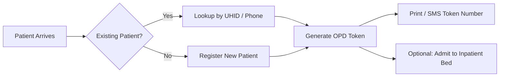
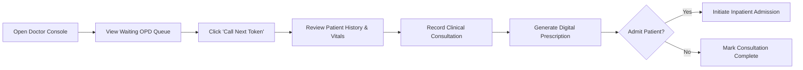
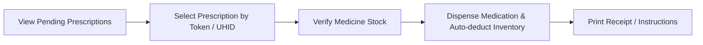

# Clinicify — User Roles & Operational Workflows

> Step-by-step role guides and operational flows across the hospital management ecosystem.

---

## 1. Receptionist Workflow

1. **Patient Registration**: Search for returning patient using phone/UHID. If new, create demographic profile.
2. **Issue OPD Queue Token**: Assign to appropriate consulting doctor. The algorithm calculates initial estimated wait time.
3. **Inpatient Bed Allocation**: If doctor advises admission, check available beds by ward and confirm bed booking.

---

## 2. Doctor Workflow

1. **Live Queue Monitoring**: See patients currently waiting with dynamic countdowns.
2. **Consultation & Diagnosis**: Record symptoms, ICD-10 notes, vitals, and diagnosis.
3. **Digital Prescription**: Add medication items with dosage, frequency, and duration.
4. **Admit Patient**: Flag visit for inpatient bed admission if critical.

---

## 3. Pharmacist Workflow

1. **Pending Prescriptions Queue**: Real-time view of prescriptions signed by doctors.
2. **Dispensing**: Review line items, confirm stock availability, and click "Dispense" (automatically updates inventory).
3. **Stock Replenishment**: Monitor low-stock alerts when quantity dips below reorder threshold.

---

## 4. Patient Self-Service Portal

* **Queue Tracker**: Real-time tracking of current token being served and estimated minutes remaining.
* **Prescription History**: View past digital prescriptions and download PDF copies.
* **Admission Status**: Track bed details and inpatient care summary.

---

## 5. Public Waiting Hall Display (:5173/display)

A dedicated fullscreen display designed for wall monitors in hospital waiting areas:
* Live display of the **Token Currently Being Served** per Doctor/Room.
* **Upcoming Tokens** in queue.
* Visual callout alerts when a new token is rung up by a doctor.
